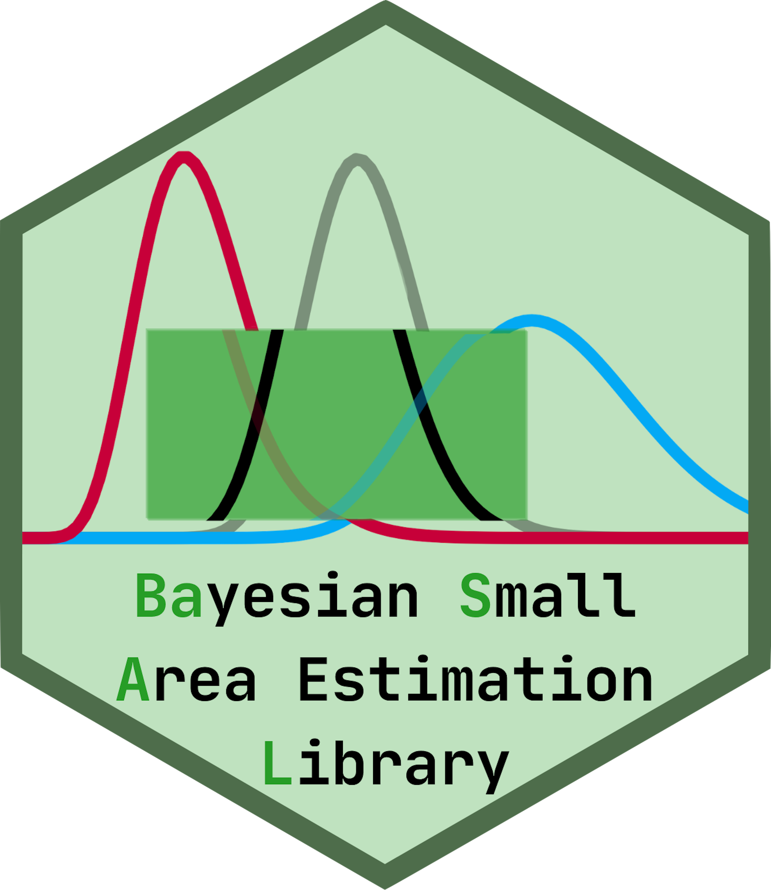

<!-- README.md is generated from README.Rmd. Please edit that file -->

```{r, include = FALSE}
knitr::opts_chunk$set(
  collapse = TRUE,
  comment = "#>",
  fig.path = "man/figures/README-",
  out.width = "50%",
  dpi = 200,
  cache.path = "man/cache/README-",
  cache = TRUE
)

fit <- function (x, ...) {
  suppressWarnings(basal::fit(x, ...))
}

estimate <- function (x, ...) {
  suppressWarnings(basal::estimate(x, ...))
}

set.seed(1)
library(basal)
data("oregon_population", "oregon_sample")
oregon_population$elev <- oregon_population$elev / sd(oregon_sample$elev)
oregon_sample$elev <- oregon_sample$elev / sd(oregon_sample$elev)

oregon_population$ppt <- oregon_population$ppt / sd(oregon_sample$ppt)
oregon_sample$ppt <- oregon_sample$ppt / sd(oregon_sample$ppt)
```

<a></a>

# Development Mode

`basal` is still under development. Please us at your own risk!

# `basal`: `Ba`yesian `S`mall `A`rea Estimation `L`ibrary

This package is intended to provide tools for Bayesian modeling within
the small area estimation context.

## Modeling Design and Example

The design of `basal` is to use a simple modeling framework for all
models. Every model starts with a call to `specify()`, detailing various
different parts of a model. For example, with the data provided here,

```{r}
bhf <- specify(biomass ~ ppt, domain_name = "evt", model = "BHF")
bhf
```

is a valid specification for a Battese-Harter-Fuller (BHF) model. Likewise,

```{r}
fh <- specify(biomass ~ ppt, domain_name = "evt", model = "FH")
fh
```

specifies a Fay-Herriot (FH) model. When estimating area-level models like a FH model, we provide the `aggregate()` functionality, to compute direct estimates:

```{r}
oregon_agg <- aggregate(
  oregon_sample, "biomass", "evt", oregon_population,
  population_size = 31000000
)
```

`basal` provides a very flexible modeling framework, and we are actively
adding more model types and terms to add to these models. The bulk of
the work for a `basal` model, however, is done in `specify()`, and the
remaining three steps in a Bayesian analysis can be done quite briefly:

```{r}
bhf_fit <- fit(bhf, oregon_sample, verbose = FALSE)
check(bhf_fit)
```

This BHF does not have sufficient model fitness, as evidenced by strong disagreement between blue and black lines (the observed data and posterior predictions) due to zero-inflation and strong right skewness of the response, but various other options such as variable transformations and zero-inflated models can address this issue. We discuss these in the vignettes.

```{r}
fh_fit <- fit(fh, oregon_agg, verbose = FALSE)
check(fh_fit)
```

This FH does have good fitness, as evidenced by the strong agreement between the lines. In either case, estimates  can be computed from each easily:

```{r}
estimate(bhf_fit, oregon_population, domain_name = "county")$preds |> head()
```

```{r}
estimate(fh_fit, domain_name = "county")$preds |> head()
```

# Installation

`basal` has not yet been released to the CRAN, you can download it from github with

```r
# install.packages("remotes")
remotes::install_github("ufds-lab/basal")
```

Or, to install through the command line, run:

```bash
git clone https://github.com/ufds-lab/basal.git
cd basal
R CMD install .
```
