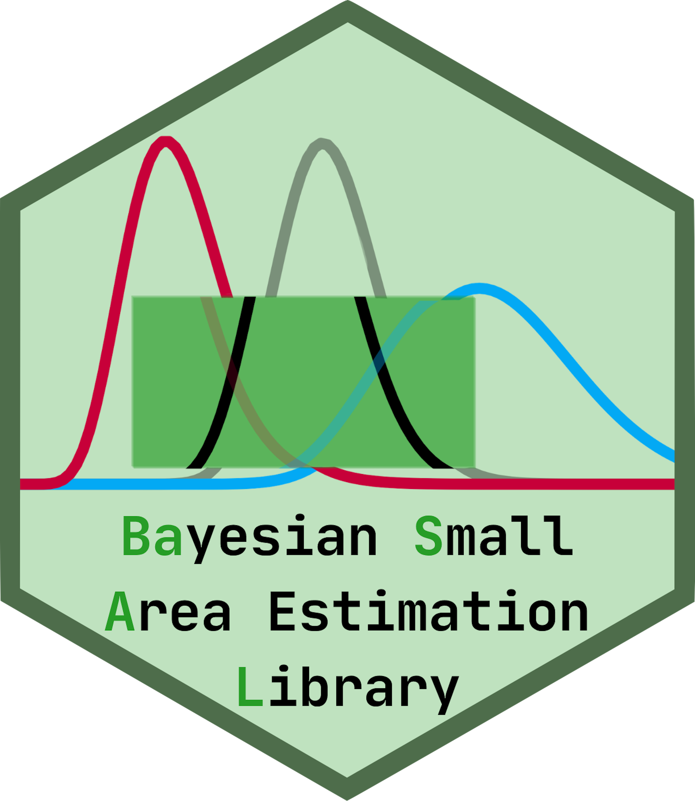
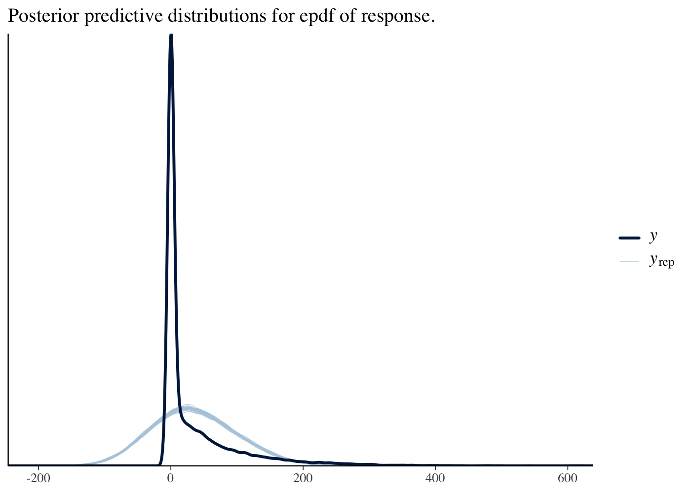
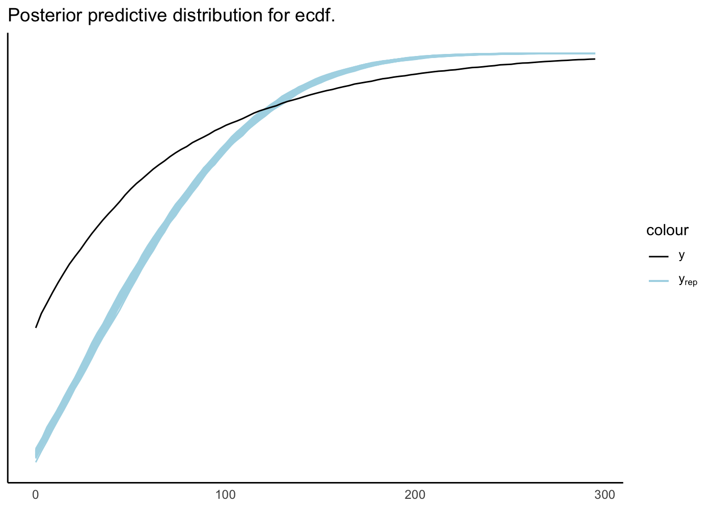
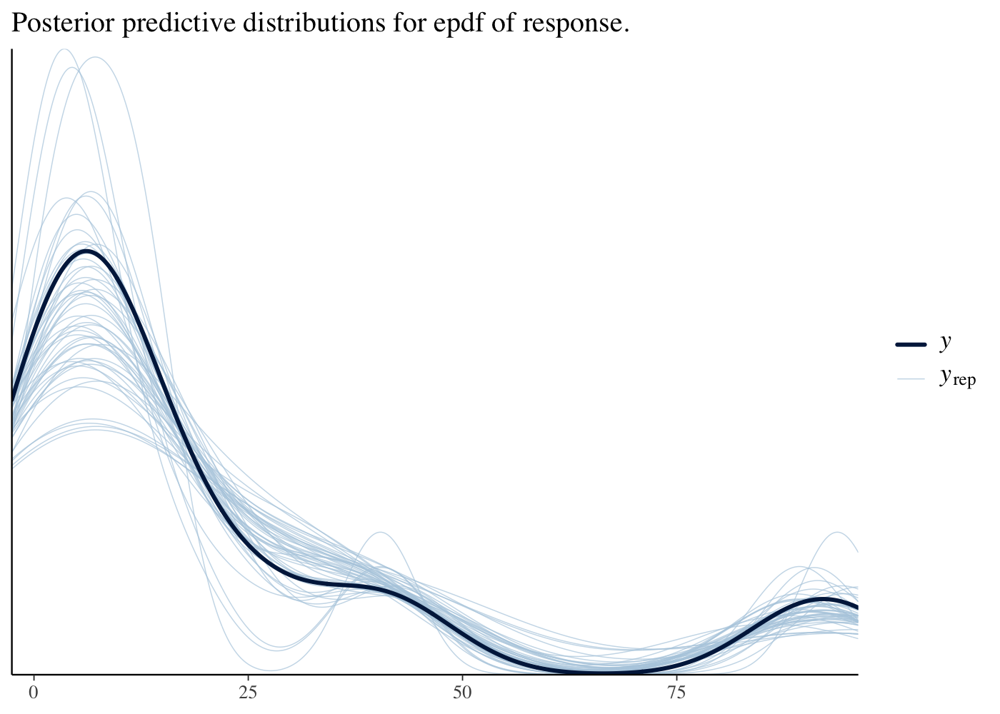
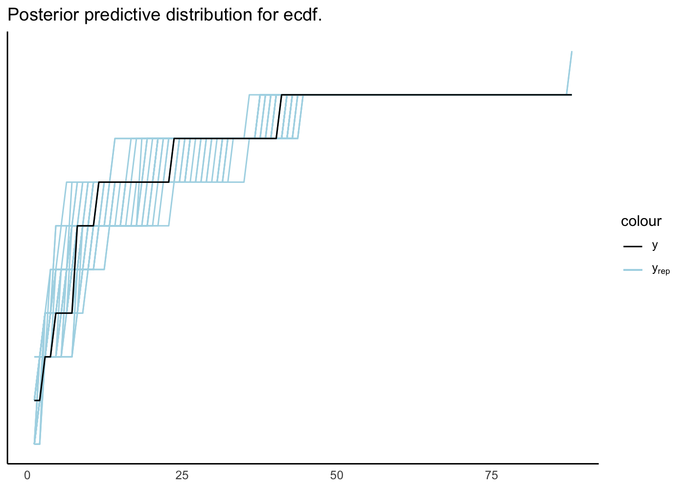

<!-- README.md is generated from README.Rmd. Please edit that file -->

<a></a>

# Development Mode

`basal` is still under development. Please us at your own risk!

# `basal`: `Ba`yesian `S`mall `A`rea Estimation `L`ibrary

This package is intended to provide tools for Bayesian modeling within
the small area estimation context.

## Modeling Design and Example

The design of `basal` is to use a simple modeling framework for all
models. Every model starts with a call to `specify()`, detailing various
different parts of a model. For example, with the data provided here,

``` r
bhf <- specify(biomass ~ ppt, domain_name = "evt", model = "BHF")
bhf
#> **BASAL model specification:**
#> BHF model of the form
#> biomass ~ ppt
#> with additional arguments:
#> Domain: evt
```

is a valid specification for a Battese-Harter-Fuller (BHF) model.
Likewise,

``` r
fh <- specify(biomass ~ ppt, domain_name = "evt", model = "FH")
fh
#> **BASAL model specification:**
#> FH model of the form
#> biomass ~ ppt
#> with additional arguments:
#> Domain: evt
```

specifies a Fay-Herriot (FH) model. When estimating area-level models
like a FH model, we provide the `aggregate()` functionality, to compute
direct estimates:

``` r
oregon_agg <- aggregate(
  oregon_sample, "biomass", "evt", oregon_population,
  population_size = 31000000
)
```

`basal` provides a very flexible modeling framework, and we are actively
adding more model types and terms to add to these models. The bulk of
the work for a `basal` model, however, is done in `specify()`, and the
remaining three steps in a Bayesian analysis can be done quite briefly:

``` r
bhf_fit <- fit(bhf, oregon_sample, verbose = FALSE)
check(bhf_fit)
```



This BHF does not have sufficient model fitness, as evidenced by strong
disagreement between blue and black lines (the observed data and
posterior predictions) due to zero-inflation and strong right skewness
of the response, but various other options such as variable
transformations and zero-inflated models can address this issue. We
discuss these in the vignettes.

``` r
fh_fit <- fit(fh, oregon_agg, verbose = FALSE)
check(fh_fit)
```



This FH does have good fitness, as evidenced by the strong agreement
between the lines. In either case, estimates can be computed from each
easily:

``` r
estimate(bhf_fit, oregon_population, domain_name = "county")$preds |> head()
#> # A tibble: 6 × 5
#>   county    predicted_mean_mean predicted_mean_var predicted_mean_lower_95_ci
#>   <fct>                   <dbl>              <dbl>                      <dbl>
#> 1 Baker                   23.2               0.310                      22.1 
#> 2 Benton                  21.3               0.411                      20.1 
#> 3 Clackamas               78.3               0.573                      76.8 
#> 4 Clatsop                125.                2.93                      122.  
#> 5 Columbia                 8.15              0.461                       6.90
#> 6 Coos                    18.2               0.495                      16.8 
#> # ℹ 1 more variable: predicted_mean_upper_95_ci <dbl>
```

``` r
estimate(fh_fit, domain_name = "county")$preds |> head()
#> # A tibble: 6 × 5
#>   county    predicted_mean_mean predicted_mean_var predicted_mean_lower_95_ci
#>   <fct>                   <dbl>              <dbl>                      <dbl>
#> 1 Baker                   14.4                8.17                       8.84
#> 2 Benton                   9.73              12.6                        2.64
#> 3 Clackamas               93.1               25.2                       82.3 
#> 4 Clatsop                186.               423.                       142.  
#> 5 Columbia                 2.48               3.76                      -1.35
#> 6 Coos                     9.30               9.19                       3.44
#> # ℹ 1 more variable: predicted_mean_upper_95_ci <dbl>
```

# Installation

`basal` has not yet been released to the CRAN, you can download it from
github with

``` r
# install.packages("remotes")
remotes::install_github("ufds-lab/basal")
```

Or, to install through the command line, run:

``` bash
git clone https://github.com/ufds-lab/basal.git
cd basal
R CMD install .
```
